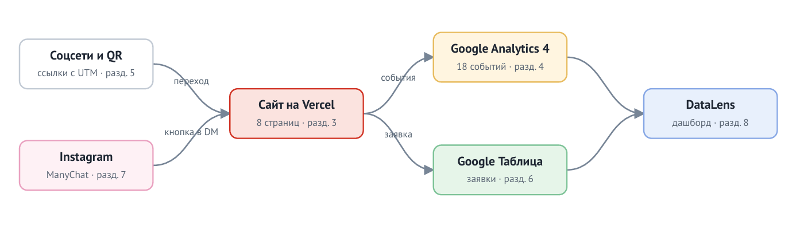

# КОЛЕСО 21 — сайт и сквозная аналитика заявок

Курсовая работа по дисциплине ОП.03 «Информационные технологии», ТЗ № ТЗ-21/2026.
Исполнитель: Станчинская Соня, группа РПО 25/9/3.

Сайт компании «КОЛЕСО 21» (сезонная переобувка без очереди): каждый посетитель приходит с меткой источника, каждая заявка попадает в Google Таблицу, а руководитель видит на дашборде, какой канал приводит клиентов.



## Ссылки

| Что | Ссылка |
|---|---|
| Сайт | [https://tz-21-shinomentazh-koleso21.vercel.app/](https://tz-21-shinomentazh-koleso21.vercel.app/) |
| Таблица заявок | [https://docs.google.com/spreadsheets/d/1TeDwWQ1Zo6oh9bWn_b27sV6YU8Iqze95l3kSVtQ_edY/edit?hl=ru&gid=0#gid=0](https://docs.google.com/spreadsheets/d/1TeDwWQ1Zo6oh9bWn_b27sV6YU8Iqze95l3kSVtQ_edY/edit?hl=ru&gid=0#gid=0) |
| Дашборд DataLens | [https://datalens.yandex/kum12vevcqqe3?_share_link=public](https://datalens.yandex/kum12vevcqqe3?_share_link=public) |
| ВКонтакте · Telegram | [https://vk.ru/club242812364](https://vk.ru/club242812364) · [https://t.me/koleso21_SHADOW](https://t.me/koleso21_SHADOW) |
| Описание работы | [docs/report.md](docs/report.md) |
| Презентация к защите | [presentation/zashchita.pdf](presentation/zashchita.pdf) |

Ресурс GA4: `G-SKPXPFBT0C`. В GA4 доступ только по почте, ссылки «для всех» нет: Viewer не выдан. Таблица и Дашборд DataLens открыты всем, у кого есть ссылка, с правом читателя.

## Что сделано

| Часть | Результат |
|---|---|
| Сайт | 9 страниц (включая 404), статический HTML, Vercel, Lighthouse: [ВСТАВЬ ОЦЕНКИ, например: 70 / 90 / 90 / 90] |
| GA4 | 20 событий, 7 пользовательских параметров, ключевые: `generate_lead`, `contact_click`, `messenger_click` |
| UTM | 12+ ссылок в реестре, публикации в ВК и Telegram, короткие ссылки `clck.ru` |
| Заявки | форма → Apps Script → лист `leads`, проверка полей и дубликатов `request_id` |
| Бот (вместо Instagram) | BotHelp для ВК, две ветки: `ШИНЫ` и `ХРАНЕНИЕ` |
| Отчёты | Reports, Explore (воронка, свободная форма), дашборд DataLens из 3-х графиков |

## Технологии

HTML, CSS, JavaScript · Google Analytics 4 · Google Таблицы и Apps Script · BotHelp · Yandex DataLens · GitHub и Vercel. Сайт создан с помощью V0 + DeepSeek и доработан вручную (запросы — в [docs/prompts.md](docs/prompts.md)).

## Структура

```text
index.html …         страницы сайта
js/                  скрипты (analytics.js, main.js, form.js)
apps-script/         приёмник заявок (Code.gs)
docs/                описание, реестр UTM, события, записка
screens/             кадры-доказательства по разделам ТЗ
presentation/        презентация к защите
```

## Итог
Не получилось: Организовать автоответы в Instagram из-за невозможности регистрации (технические ограничения Meta). Функционал автоответов полностью перенесен во ВКонтакте через BotHelp.
Нейросеть использовалась для: Генерации HTML/CSS каркаса, написания JS-скриптов (калькулятор, валидация формы, сохранение UTM-меток), настройки отправки данных в Google Sheets и исправления ошибки CORS.