# Описание работы · ТЗ № ТЗ-21/2026 · «КОЛЕСО 21»

**Исполнитель:** [Станчинская Соня], группа [РПО 25/9/3]
**Сайт:** https://tz-21-shinomentazh-koleso21.vercel.app
**Период проверок:** 30 октября — 1 ноября 2026

## 1. Задача заказчика

Компания «КОЛЕСО 21» получает заявки из социальных сетей (ВКонтакте, Telegram), но не знает, какой канал приводит клиентов. В сезон 2025 года в пиковые дни очередь на выезде доходила до 3 часов, часть клиентов уезжала. Записи велись администраторами в переписках, пересечения по времени случались каждый день.
Задача — создать сайт, на котором видно источник каждого посетителя, настроить онлайн-запись без очередей, объединить все заявки в одну таблицу и автоматизировать ответы.

## 2. Схема работы

Посетитель приходит из соцсетей (ВК, Telegram) по ссылке с UTM-метками. Сайт отправляет события в GA4, а заявку — в Google Таблицу через Apps Script. Данные GA4 и таблицы собираются на дашборде DataLens. Вместо Instagram используется сообщество ВКонтакте с чат-ботом.

Схема на Mermaid

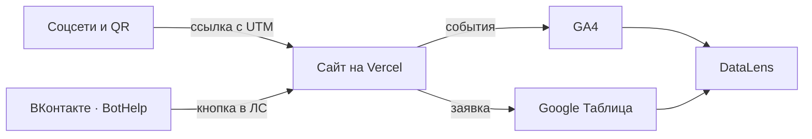

## 3. Сайт

Сайт из 9 страниц (включая 404) создан с помощью нейросети (ChatGPT/Claude) и доработан вручную: настроена адаптивность под мобильные устройства, исправлена ошибка CORS при отправке формы. Опубликован на Vercel, обновляется после каждого push.

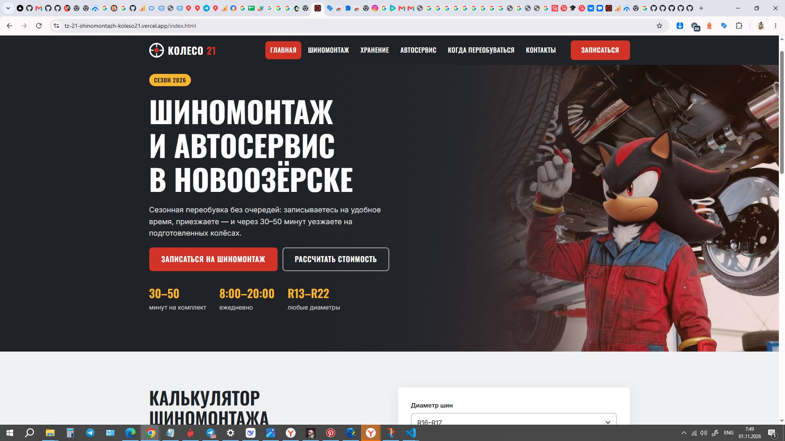
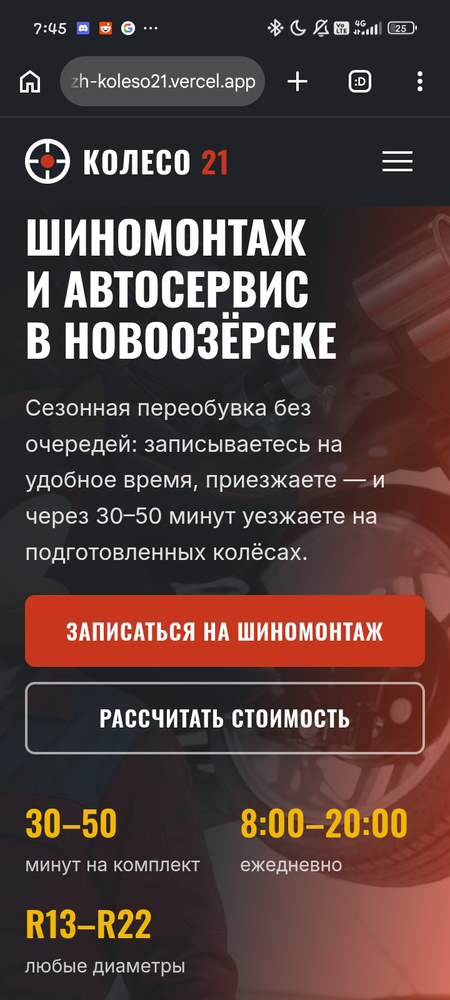
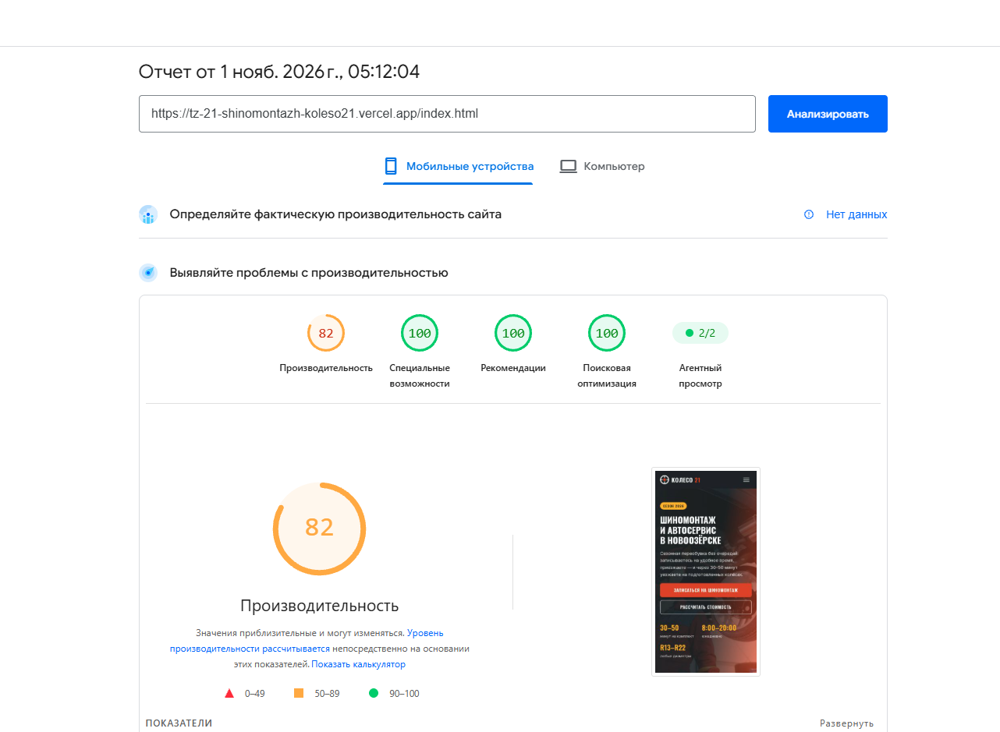

## 4. Аналитика GA4

Настроено 20 событий, из них 14 своих (кастомных). Ключевые события: `generate_lead`, `contact_click`, `messenger_click`. Каждое событие проверено в DebugView.

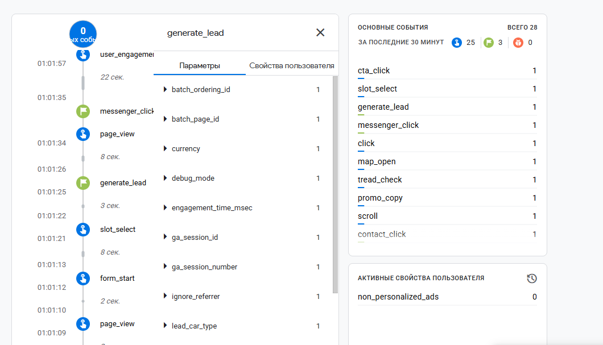
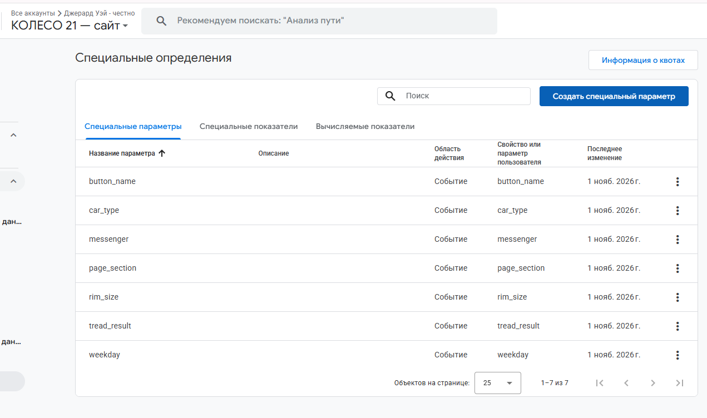

## 5. UTM-ссылки и соцсети

В реестре 12 ссылок, опубликованы в ВКонтакте и Telegram. Для сокращения использовались сервисы `clck.ru` и `vk.cc`. Также была попытка публикации в Pinterest.

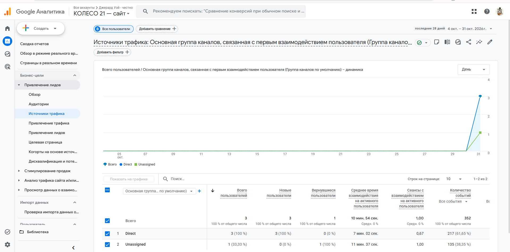

## 6. Заявки

Форма отправляет заявку в Apps Script (`doPost`), тот проверяет поля, формат телефона и записывает строку в лист `leads` вместе с метками. Повторная отправка не создаёт дубль (проверка по `request_id`).

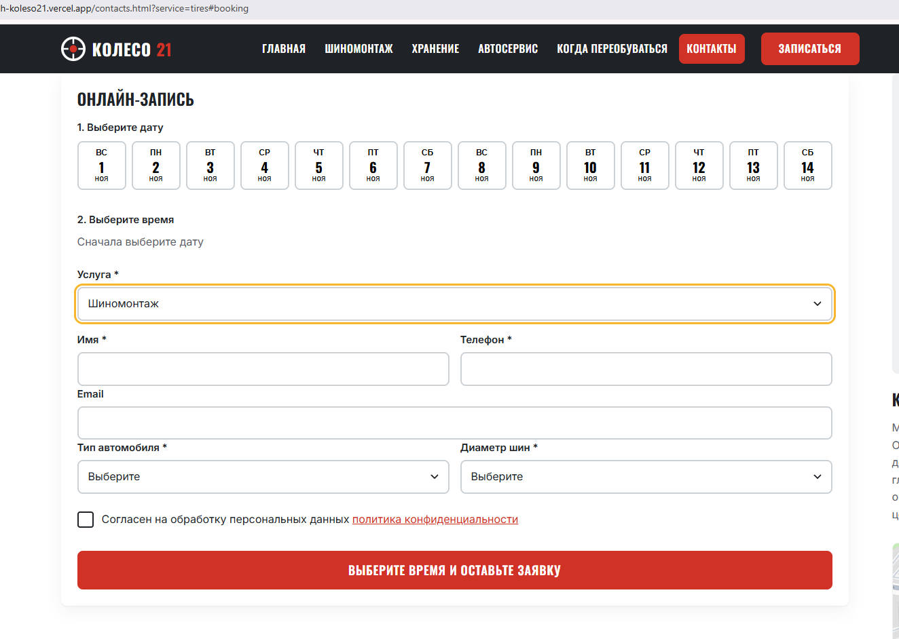
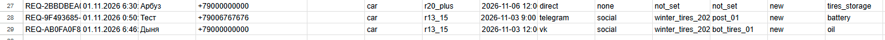

## 7. Автоответы (замена Instagram на ВК)

В связи с невозможностью регистрации в Instagram (ошибка Meta) автоответы настроены во ВКонтакте через сервис BotHelp. Сообщение с ключевым словом «ШИНЫ» запускает отправку памятки в ЛС с кнопкой на сайт. Вторая ветка — слово «ХРАНЕНИЕ» (отправляет прайс и ссылку на страницу хранения).

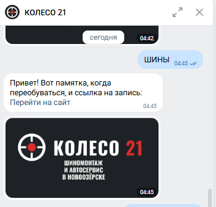
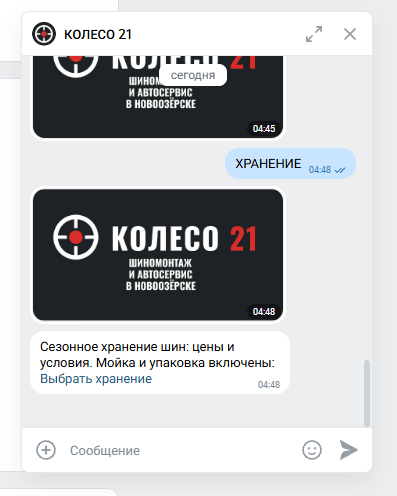

## 8. Отчёты и дашборд

Воронка показала наибольшую потерю между `page_view` и `form_start` (пользователи изучают цены). Больше всего заявок принёс канал Direct и Telegram. 

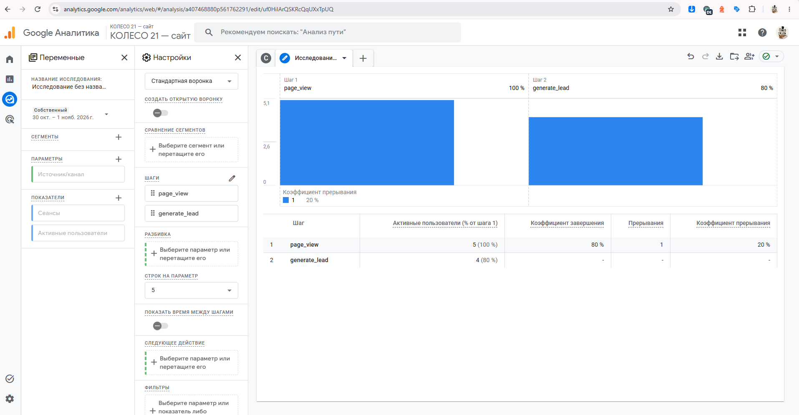
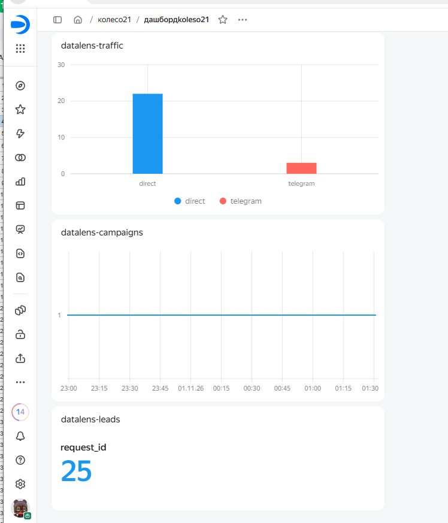

## 9. Что получил бизнес

| Было | Стало |
|---|---|
| заявки в личных сообщениях разных аккаунтов | все заявки в одной таблице со статусом |
| источник клиента неизвестен | у каждой заявки есть source, medium, campaign |
| бюджет делится «по ощущениям» | на дашборде видно заявки по каждому каналу |
| ответы на сообщения вручную | Бот в ВК отвечает сразу и ведёт на сайт |

Рекомендация заказчику: Судя по данным воронки, пользователи активно кликают по карточкам услуг, но не всегда доходят до формы. Рекомендуется добавить на страницу «Шиномонтаж» более заметную кнопку «Записаться» и выводить промокод прямо в форме.

## 10. Итог

Не получилось: Организовать автоответы в Instagram из-за блокировки регистрации (заменено на ВК).
ИИ использовался для: Генерации HTML/CSS, написания JS-скриптов (калькулятор, валидация, сохранение UTM) и помощи с настройкой интеграции Google Sheets.